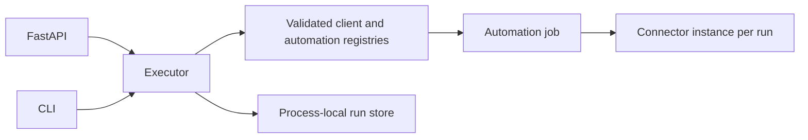

# ORBELION Automations

Public engineering case study of a modular automation framework.

This portfolio documents verified patterns from a private project. It has independent Git history and contains only original explanatory documentation and a standalone synthetic example. It is not the private application or a production service.

## Architecture



The private framework shares one executor across Python, CLI and FastAPI. Client YAML selects registered automation IDs and connector aliases; it cannot import arbitrary Python classes. Configuration uses Pydantic validation and rejects unknown fields and duplicate YAML keys.

## Verified capabilities

- Synthetic job and mock connector without network or external writes.
- Client and automation registries with explicit enablement.
- Structured run results and correlated JSON logging.
- Process-local atomic idempotency reservation scoped by client, automation and key.
- Conflicting input under an existing key is rejected; failed runs retain their key.
- API authorization fails closed by default; an explicit development bypass is rejected in production.
- Secrets are referenced through environment variable names rather than stored in client YAML.

These describe the inspected private implementation, not features provided by this small public example. See [the evidence matrix](docs/VERIFIED_CAPABILITIES.md).

## Runnable example

Python 3.11 or newer; standard library only:

```sh
python examples/synthetic_job.py
python -m unittest discover -s tests -v
python scripts/validate_publication.py
```

The example validates and counts synthetic records. It performs no network calls, persistence, authentication or scheduling.

## Reliability limits

The source framework is a local development implementation. Run history and idempotency disappear on restart and are not shared between processes. It has no tenant-bound identity authorization, durable queue, scheduler, automatic retries, cancellation or production secret manager. A business operation still needs its own idempotency and reconciliation controls.

Before production, implement durable atomic reservations, recovery after interrupted jobs, bounded execution, authenticated tenant authorization, retention and operational monitoring. This is roadmap, not delivered functionality.

## Publication boundary

See [PUBLICATION_SCOPE.md](PUBLICATION_SCOPE.md), [SECURITY.md](SECURITY.md) and [maintenance guidance](docs/MAINTENANCE.md). The private source remains in its existing repository. No automatic synchronization or private Git history is published.
