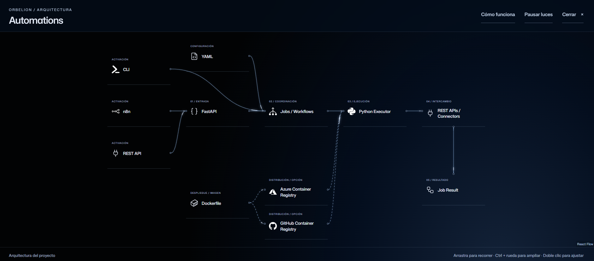

# ORBELION Automations

A modular automation framework designed around validated configuration, one shared execution boundary and explicit failure handling.

This public portfolio explains the engineering behind a private Python project: how execution is composed, why duplicate work is controlled, how failures are reported, and what must change before production. It includes an original synthetic example and an approved architecture image; private application code, customer configuration and Git history remain excluded.

## Workflow overview

[](docs/assets/automations-workflow.png)

**Architecture illustration, with future integration options.** CLI, YAML configuration, FastAPI, registered jobs, the Python executor and structured results exist in the inspected source. Only a mock connector and synthetic job are registered. n8n, external REST integrations, Docker packaging, Azure Container Registry and GitHub Container Registry are design options in the image; their implementation or deployment is not claimed.

The picture presents a conceptual flow. In the implemented framework, both CLI and API call the same executor, which resolves the registries and invokes a job with a connector instance.

## Engineering demonstrated

| Engineering concern | Implemented approach | Why it matters |
| --- | --- | --- |
| Transport-independent execution | Python, CLI and FastAPI share an executor | Validation and execution rules stay consistent |
| Configurable client workflows | Typed YAML, registered IDs, connector compatibility and enablement | Configuration cannot select arbitrary Python classes |
| Duplicate requests | Atomic reservation by client, automation and idempotency key | Concurrent callers reuse the same run within one process |
| Partial failure | Failed keys retained; no implicit retry | Avoids silently repeating potentially completed side effects |
| Resource lifecycle | Connector created per run and closed in finally | Makes cleanup and cleanup failures explicit |
| Safe operational feedback | Structured results, correlation IDs, controlled error codes | Supports diagnosis without exposing raw external exceptions |
| Access boundary | Operational API fails closed without an identity provider | A local development bypass cannot stand in for production authorization |

Read the [engineering case study](docs/ENGINEERING_CASE_STUDY.md) for the execution sequence, tradeoffs and failure matrix. The [verified capability matrix](docs/VERIFIED_CAPABILITIES.md) identifies private source evidence.

## Execution evidence

On **2026-10-26**, the private framework suite was rerun against revision `6bab643197e8625ccd2803e24049de35cf2c93ee`: **35 passed, 1 warning**. It covers configuration rejection, logical client separation, concurrent duplicate requests, failed-run reuse, cleanup, sanitized errors, API behavior and CLI execution.

This is a maintainer-reported local result from the private checkout. Public CI cannot inspect that source. See [execution evidence and its limits](docs/EXECUTION_EVIDENCE.md) for commands, test names and the remaining warning.

## Run the public example

Python 3.11 or newer; standard library only:

```sh
python examples/synthetic_job.py
python -m unittest discover -s tests -v
python scripts/validate_publication.py
```

Expected example output:

```json
{"status": "success", "records_processed": 3}
```

The public example demonstrates bounded input validation and a predictable result contract. Its tests exercise defaults, bounds and invalid types, including booleans. It has no network calls, persistence, authentication, scheduling or idempotency implementation; those framework concerns are documented separately.

## Production readiness

The implemented framework is a **local development foundation**. Run history and keys disappear on restart and are not shared between processes. There is no tenant-bound identity authorization, durable queue, scheduler, automatic retry, cancellation or production secret manager.

A production release requires durable atomic reservations and recovery, business-level idempotency and reconciliation, bounded execution, identity-to-tenant authorization, retention and monitoring. These are next steps, not delivered capabilities. A single-process lock does not provide distributed exactly-once execution.

## Repository guide

- [Engineering case study](docs/ENGINEERING_CASE_STUDY.md): decisions, execution lifecycle and failure handling.
- [Execution evidence](docs/EXECUTION_EVIDENCE.md): validation results and reproducibility boundaries.
- [Verified capabilities](docs/VERIFIED_CAPABILITIES.md): implementation references.
- [Publication scope](PUBLICATION_SCOPE.md), [security](SECURITY.md) and [maintenance](docs/MAINTENANCE.md): public/private separation.

This curated public companion has independent history and no automatic synchronization with the private application.
